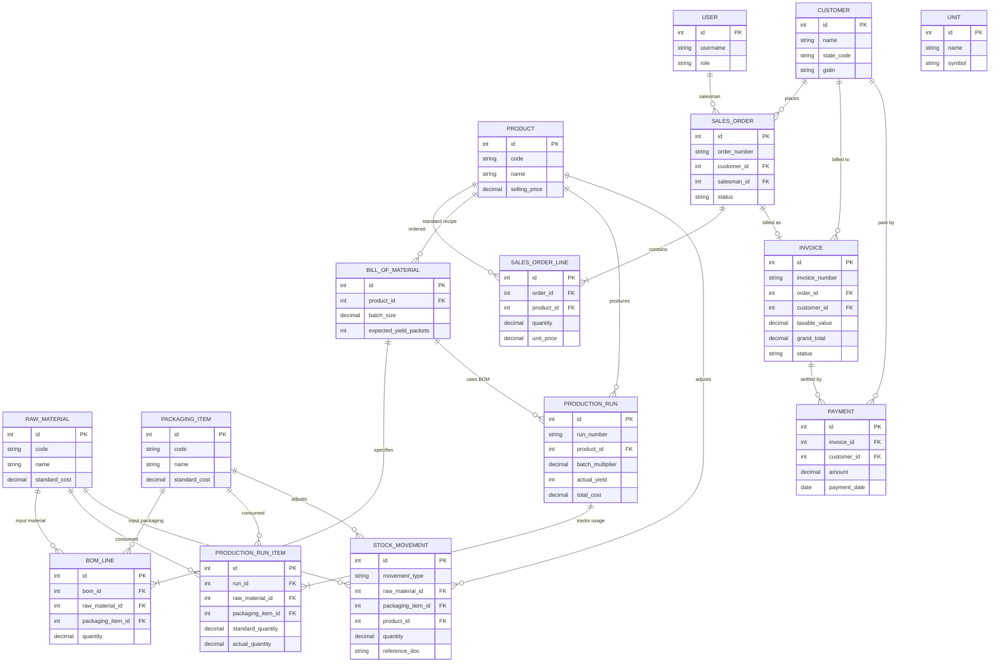

# System Architecture & Design Note

**Order-to-Audit System for Small Food Manufacturers**  
*Centre for Digital Infrastructure, NIT Tiruchirappalli — Internship Technical Project*

---

## 1. Data Model

Master items (`RAW_MATERIAL`, `PACKAGING_ITEM`, `PRODUCT`) define item attributes and anchor the append-only `STOCK_MOVEMENT` ledger where all physical quantity adjustments are recorded. Finished products link to recipe `BILL_OF_MATERIAL` formulas containing `BOM_LINE` specifications; these recipes are instantiated during manufacturing into `PRODUCTION_RUN` and itemized `PRODUCTION_RUN_ITEM` rows. Field orders booked by salesmen (`USER`) for a `CUSTOMER` create `SALES_ORDER` records with `SALES_ORDER_LINE`s, which on admin approval generate a posted `INVOICE`, deduct inventory upon dispatch, and track collections through linked `PAYMENT` receipts.

---

## 2. Stock and BOM Consumption Computation

* **Append-only stock ledger:** Inventory balances are never stored as mutable counters or directly overwritten; stock on hand is dynamically calculated as the sum of all signed ledger movements:
  $$\text{Stock Balance} = \sum (\text{Opening} + \text{Purchases} + \text{Production Outputs} - \text{Production Issues} - \text{Dispatches} \pm \text{Adjustments})$$
* **Document linkage:** Every `StockMovement` row is strictly linked to an identifiable source document (`reference_doc`), such as a Purchase Receipt, Production Run number, Dispatch Invoice, or physical Audit Adjustment, ensuring complete traceability.
* **Planned BOM consumption:** Standard consumption is derived by scaling recipe lines by the production batch multiplier:
  $$\text{Planned Quantity} = \text{BOM Standard Quantity} \times \text{Batch Multiplier}$$
* **Actual consumption & scrap:** Floor operators record actual quantities issued and scrap (e.g., damaged pouches); raw materials and packaging are deducted from stock upon issue, and good finished packets are credited to inventory when production output is logged.
* **Variance calculation & tolerance flags:** Percentage variance is computed for each material and overall yield:
  $$\text{Variance \%} = \left(\frac{\text{Actual Quantity} - \text{Planned Quantity}}{\text{Planned Quantity}}\right) \times 100$$
  Variances exceeding the configured run tolerance (default $\pm 3.00\%$) trigger directional alerts (`OVER` in red for excess usage, `UNDER` in amber for lower usage) and are summarized in run headers.
* **Unit conversion:** All quantity calculations evaluate through a base-unit conversion engine using explicit decimal ratios (e.g., $1\text{ carton} = 20\text{ packets}$, $1\text{ kg} = 1000\text{ g}$, $1\text{ litre} = 1000\text{ ml}$) to prevent fractional rounding drift across different operational units.

---

## 3. Costing and Valuation

* **Weighted average method:** Raw material and packaging inventories are valued using the perpetual moving Weighted Average Cost (WAC) method, recalculated on every inward receipt:
  $$\text{WAC}_{\text{new}} = \frac{(\text{Current Qty} \times \text{Current Cost}) + (\text{Receipt Qty} \times \text{Purchase Rate})}{\text{Current Qty} + \text{Receipt Qty}}$$
* **Flour example:** An opening balance of $100\text{ kg} @ \text{₹}42.00/\text{kg} = \text{₹}4,200.00$ combined with a new purchase of $60\text{ kg} @ \text{₹}45.00/\text{kg} = \text{₹}2,700.00$ yields a weighted average unit rate of:
  $$\text{WAC} = \frac{\text{₹}4,200.00 + \text{₹}2,700.00}{100\text{ kg} + 60\text{ kg}} = \frac{\text{₹}6,900.00}{160\text{ kg}} = \mathbf{\text{₹}43.125/\text{kg}}$$
  When 40 kg is issued to production, it is costed at ₹43.125/kg, resulting in an exact raw material cost of ₹1,725.00.
* **Overhead allocation rule:** Direct labour (₹1,200.00) and power/gas utilities (₹600.00) recorded for a production run are charged fully and directly to that specific run's product batch rather than being diluted across arbitrary monthly estimates.
* **Cost per packet calculation:** Total batch production cost absorbs raw materials, packaging (including damaged pouches), labour, and utilities, divided strictly by actual good packets produced:
  $$\text{Cost per Packet} = \frac{\text{Total Run Cost (Materials + Packaging + Labour + Power)}}{\text{Actual Good Packets Produced}}$$
  In the benchmark run:
  $$\text{Cost per Packet} = \frac{\text{₹}3,435.00 (\text{RM}) + \text{₹}620.00 (\text{PKG}) + \text{₹}1,800.00 (\text{Overheads})}{188\text{ good packets}} = \frac{\text{₹}5,855.00}{188} = \mathbf{\text{₹}31.14/\text{packet}}$$
* **Reason for choosing weighted average:** In food manufacturing, bulk staples (flour, oil, spices) are fungible and stored in common bins or tanks where separate batch/lot tracking (FIFO/LIFO) is physically impossible on the factory floor. Weighted average naturally blends price fluctuations across procurement cycles and complies with Indian Accounting Standards (Ind AS 2 / AS 2) for inventory valuation and Cost of Goods Sold (COGS).
